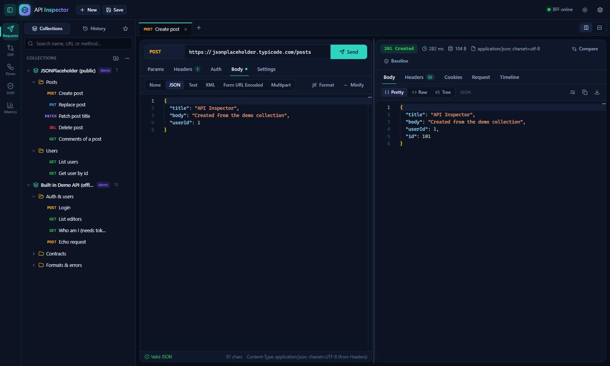
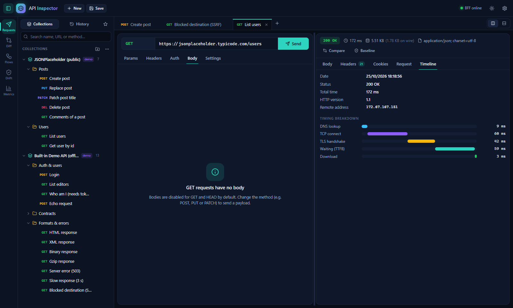
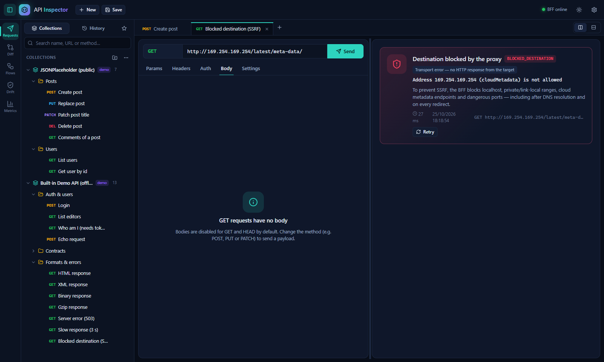
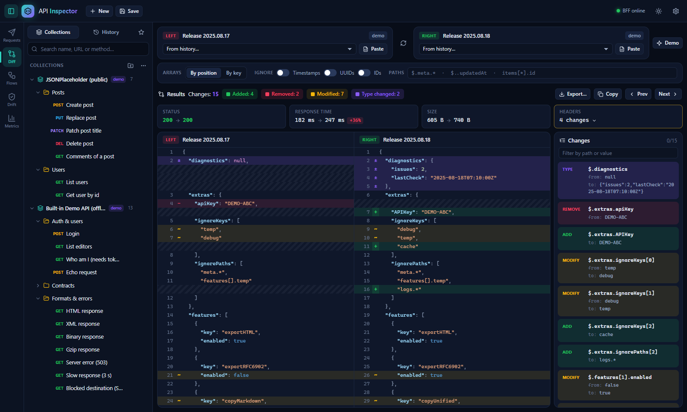
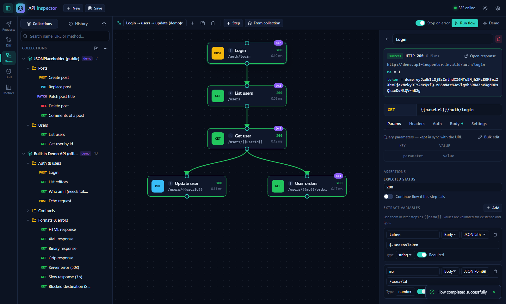
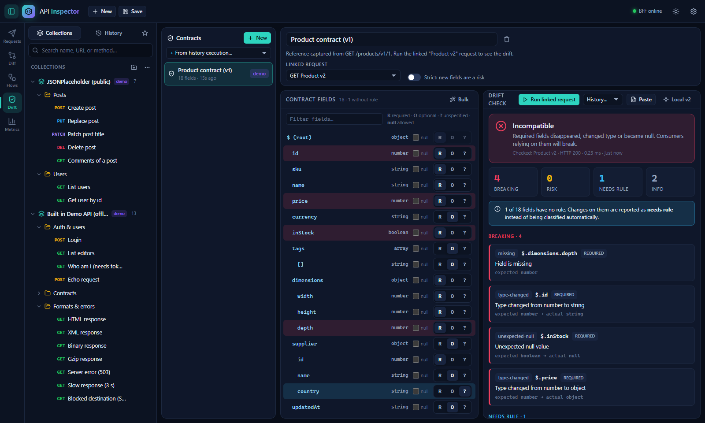
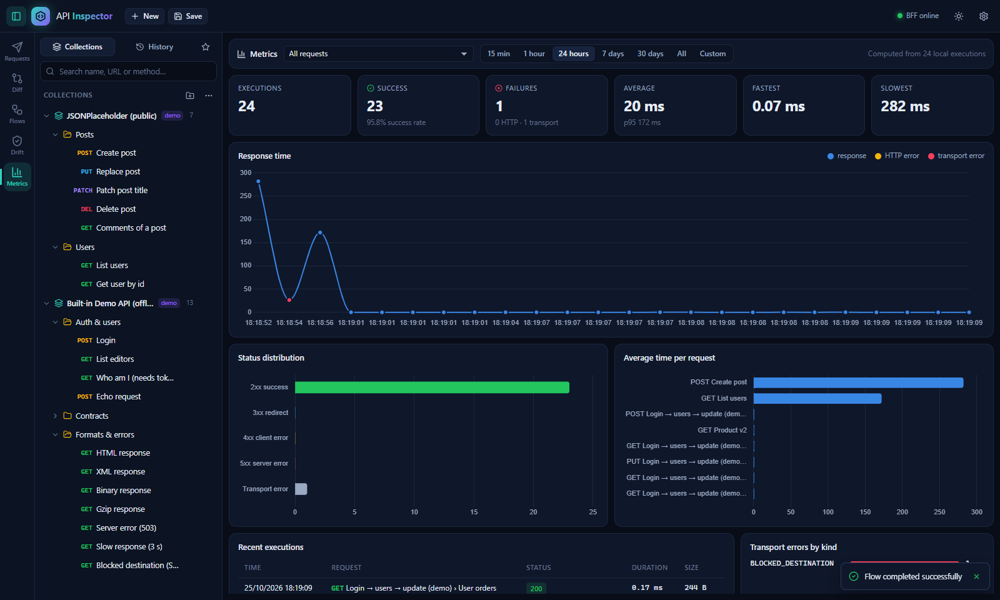
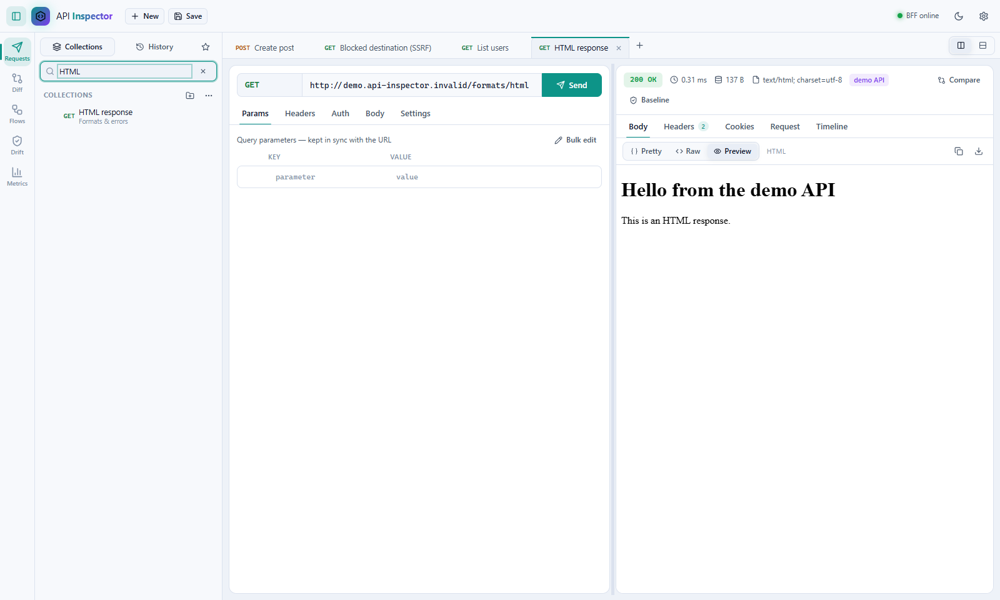
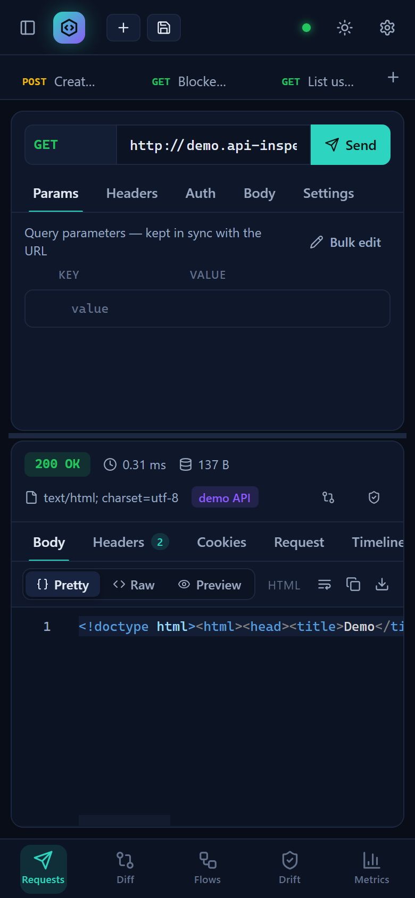
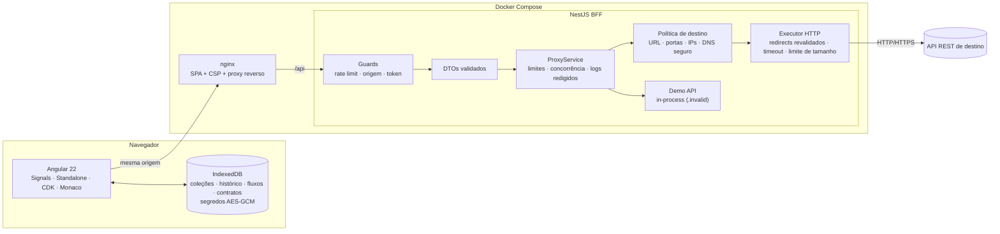

<div align="center">

# 🔍 API Inspector

**Plataforma visual para testar, comparar e monitorar APIs REST — com um BFF seguro contra SSRF.**




</div>

---

## Sumário

- [Visão geral](#visão-geral)
- [Funcionalidades](#funcionalidades)
- [Execução rápida (Docker)](#execução-rápida-docker)
- [Desenvolvimento local](#desenvolvimento-local)
- [Arquitetura](#arquitetura)
- [Segurança](#segurança)
- [Configuração](#configuração)
- [Demonstrações incluídas](#demonstrações-incluídas)
- [Testes](#testes)
- [Decisões técnicas](#decisões-técnicas)
- [Limitações conhecidas](#limitações-conhecidas)

---

## Visão geral

O **API Inspector** é uma ferramenta para desenvolvedores, inspirada em Postman e Insomnia, que executa requisições HTTP **reais** através de um BFF (Backend for Frontend) em NestJS. Além do essencial (métodos, params, headers, auth, body, resposta), traz três recursos próprios:

| | Recurso | O que faz |
|---|---|---|
| 🔀 | **Smart API Diff** | Compara duas respostas (status, headers, tempo e estrutura JSON) lado a lado, com caminhos JSON, estratégia de arrays e ignorar campos dinâmicos. |
| 🧩 | **API Flow Visual** | Monta fluxos de chamadas encadeadas num canvas, extrai variáveis (JSONPath/JSON Pointer) e reaproveita em etapas seguintes. |
| 🛡️ | **Contract Drift Detector** | Salva uma resposta como contrato e detecta campos removidos, mudanças de tipo, nulos inesperados e campos novos — classificando pelo que você configurou. |

Tudo funciona **sem banco de dados**: os dados ficam no navegador (IndexedDB), com segredos criptografados.

---

## Funcionalidades

### Workspace de requisições

- Métodos **GET, POST, PUT, PATCH, DELETE, HEAD, OPTIONS**; botões **Send** (`Ctrl+Enter`) e **Cancel** (cancela também a chamada no BFF).
- **Abas de requisição** reordenáveis (drag & drop), indicador de alterações não salvas, menu de contexto (renomear, salvar como, duplicar, fechar outras).
- **Params** sincronizados com a URL nos dois sentidos, com checkbox para habilitar/desabilitar.
- **Headers** com autocomplete (Authorization, Content-Type, Accept, Accept-Language, Cache-Control, If-None-Match, If-Modified-Since, X-API-Key, User-Agent…), headers personalizados, aviso para headers controlados pelo proxy e **bulk edit**.
- **Auth**: No Auth, Bearer, Basic, API Key em header ou query — aplicada no BFF, nunca gravada no histórico.
- **Body**: JSON, Texto, XML, Form URL Encoded e Multipart (com upload de arquivos). Editor **Monaco** com destaque de sintaxe, numeração de linhas, formatação, minificação e validação JSON com linha/coluna do erro (clicável). GET/HEAD não têm body por padrão.
- **Painéis redimensionáveis** (lado a lado ou empilhados) e layout responsivo.

### Resposta

- Resumo: **status**, tempo total, tamanho (decodificado e no fio), Content-Type, redirecionamentos e URL final.
- Body em **Pretty** (Monaco), **Raw**, **Tree** (árvore colapsável; clique na chave copia o JSONPath) e **Preview** (HTML em `iframe sandbox` sem scripts; imagens). Copiar e baixar.
- Conteúdo binário mostrado como hex dump com download; respostas grandes são truncadas com aviso.
- **Headers** com busca, **Cookies** com valores sensíveis mascarados, aba **Request** (headers enviados, mascarados, e os descartados pelo proxy) e **Timeline** (DNS, TCP, TLS, TTFB, download).
- **Erros de transporte** (timeout, DNS, conexão recusada, TLS, destino bloqueado…) são distinguidos de **erros HTTP** (4xx/5xx).

| Timeline da execução | Erro de transporte (SSRF bloqueado) |
|---|---|
|  |  |

### 🔀 Smart API Diff

Selecione duas execuções do histórico (da mesma requisição ou de requisições diferentes), cole JSON, ou carregue o demo local.

- Comparação de **status, headers (com lista de headers ignorados), tempo e tamanho**.
- Diff estrutural com **linhas alinhadas lado a lado**: 🟩 adicionado, 🟥 removido, 🟨 modificado, 🟪 tipo alterado; o lado faltante recebe hachura.
- Painel de mudanças com **caminhos JSON** (`$.features[1].enabled`), filtro, navegação **Prev/Next** e ação "ignorar este caminho".
- **Arrays por posição ou por chave identificadora** (`$.users[id=3].name`).
- Ignorar **timestamps, UUIDs e IDs** automaticamente e caminhos como `$.meta.*`, `$..updatedAt`, `items[*].id`.
- Exportação em **JSON** ou **Markdown**; renderização virtualizada (CDK Virtual Scroll) para documentos grandes. Respostas não-JSON usam diff de texto (LCS).



### 🧩 API Flow Visual

- Canvas com nós arrastáveis (CDK Drag & Drop), conexões SVG (clique na porta de saída e depois na de entrada), detecção de ciclos.
- Execução **sequencial em ordem topológica**, com status, código HTTP e tempo por etapa, animação do percurso e **destaque do nó que falhou**.
- **Extração de variáveis** por JSONPath ou JSON Pointer (body), header ou status, com validação de **existência e tipo**; uso como `{{token}}` em URL, headers, auth e body.
- Parar o fluxo no primeiro erro (configurável) ou continuar em etapas específicas; asserções de status (`2xx`, `200,201`, `200-299`, `!5xx`).
- Variáveis iniciais, resumo da última execução e acesso à resposta completa de cada etapa.



### 🛡️ Contract Drift Detector

- Crie um contrato a partir da resposta atual, de uma execução do histórico ou de JSON colado.
- Campos inferidos com tipos; marque cada um como **obrigatório (R)**, **opcional (O)** ou **não especificado (?)** e se aceita `null`. Ações em massa e sugestão a partir da referência.
- Verifique contra a requisição vinculada, o histórico ou JSON colado. O relatório é recalculado **ao vivo** quando você muda as regras.
- Classificação baseada em regras — **nem toda mudança é breaking**:

| Mudança | Obrigatório | Opcional | Não especificado |
|---|---|---|---|
| Campo ausente | 🔴 Breaking | ⚪ Info | 🔵 *Precisa de regra* (informação insuficiente) |
| Tipo alterado | 🔴 Breaking | 🟠 Risco | 🟠 Risco |
| Nulo inesperado | 🔴 Breaking | 🟠 Risco | 🟠 Risco |
| Campo novo | ⚪ Info (aditivo) — 🟠 Risco no modo estrito | | |

Arrays vazios são sinalizados como "não verificáveis"; ausências parciais em itens de array contam ocorrências; campos já ausentes em parte da referência são tratados como opcionais por observação.



### 📊 Métricas

Calculadas a partir das execuções registradas localmente, com filtro por **requisição** e **período** (15 min a 30 dias, ou intervalo personalizado): total, sucessos, falhas (HTTP × transporte), taxa de sucesso, média, p95, mínimo e máximo, gráfico de tempo de resposta, distribuição de status, tempo médio por requisição, erros por tipo e tabela das execuções recentes.



### Coleções, histórico e favoritos

- Coleções com **pastas aninhadas**, criação/renomeação/duplicação/exclusão, **favoritos** e pesquisa por nome, URL ou método.
- Histórico agrupado por dia (abrir, comparar, virar baseline, excluir); limite configurável.
- **Importação/exportação** no formato JSON próprio (`"format": "api-inspector"`), incluindo fluxos e contratos — **segredos nunca são exportados**.

### Temas e responsividade

Tema **escuro por padrão** e tema claro; layout adaptado para tablets e celulares (sidebar em gaveta e navegação inferior).

| Tema claro | Mobile |
|---|---|
|  |  |

---

## Execução rápida (Docker)

Pré-requisito: Docker com Compose v2.

```bash
docker compose up --build
```

Abra **http://localhost:8080**. Na primeira execução, coleções, fluxo e contrato de demonstração são criados automaticamente.

- O **BFF não é publicado** no host: só é acessível pelo nginx do frontend (`/api` → `bff:3000`).
- Porta diferente: `FRONT_PORT=9000 docker compose up --build`.
- Variáveis do BFF podem ser passadas pelo ambiente ou por um arquivo `.env` na raiz (ver [Configuração](#configuração)).

---

## Desenvolvimento local

Pré-requisitos: Node.js 22+ (testado com Node 24) e npm.

```bash
# Terminal 1 — BFF (http://localhost:3000/api)
cd bff
npm install
cp .env.example .env
npm run start:dev

# Terminal 2 — Frontend (http://localhost:4200)
cd front
npm install
npm start          # /api é encaminhado ao BFF via proxy.conf.json
```

> Para testar APIs rodando na sua própria máquina, defina `PROXY_ALLOW_PRIVATE_NETWORKS=true` **apenas em desenvolvimento**. Endpoints de metadados de nuvem continuam bloqueados.

---

## Arquitetura



**Fluxo de uma requisição:** o Angular monta um payload (`método, URL, headers, auth, body, opções`) e envia a `POST /api/proxy/execute`. O BFF valida o DTO, aplica rate limit e limite de concorrência, constrói a requisição (auth aplicada no servidor, headers proibidos descartados), valida o destino, resolve o DNS validando **cada IP** e conecta exatamente ao IP validado. Redirecionamentos são seguidos manualmente, revalidando cada salto. A resposta volta num envelope com status, headers (sem hop-by-hop), cookies, corpo (texto decodificado ou base64), timings e avisos. Falhas de transporte retornam um envelope de erro com `kind` estável (`TIMEOUT`, `DNS_FAILURE`, `TLS_ERROR`, `BLOCKED_DESTINATION`…).

O BFF **não contém regra de negócio** das APIs consultadas: preserva método, headers, query, body, status e resposta originais.

### Estrutura

```
apiinspector/
├── docker-compose.yml
├── bff/                         # NestJS
│   ├── src/
│   │   ├── config/              # configuração tipada via variáveis de ambiente
│   │   ├── common/              # filtro global de exceções, guard de acesso, redação de logs
│   │   ├── proxy/
│   │   │   ├── dto/             # DTOs com class-validator
│   │   │   ├── security/        # políticas de IP, URL, headers e DNS seguro
│   │   │   ├── http/            # builder, executor, decodificação, cookies
│   │   │   └── concurrency/     # limitador global e por cliente
│   │   ├── demo/                # API de demonstração in-process
│   │   └── health/
│   └── test/                    # testes de integração com servidores HTTP locais
└── front/                       # Angular
    └── src/app/
        ├── core/                # modelos, utilitários puros (diff, drift, JSONPath, flow runner), serviços, stores
        ├── shared/              # Monaco, editor chave/valor, árvore JSON, split pane, gráficos, diálogos
        ├── layout/              # top bar, activity bar, sidebar
        └── features/            # workspace, diff, flows, drift, metrics
```

---

## Segurança

### Proteções do BFF

| Ameaça | Mitigação |
|---|---|
| Protocolos perigosos | Somente `http:` e `https:`; credenciais embutidas na URL são rejeitadas. |
| SSRF para rede interna | Bloqueio de `localhost`, loopback, faixas privadas, link-local, CGNAT, multicast, reservadas, IPv4-mapped IPv6, NAT64, 6to4/Teredo e nomes `.local/.internal/.localhost`. Só IPs **unicast públicos** são permitidos. |
| Metadados de nuvem | `169.254.169.254`, `169.254.170.2`, `fd00:ec2::254`, `100.100.100.200`, `metadata.google.internal`… sempre bloqueados (mesmo com redes privadas liberadas). |
| Formas alternativas de IP | `http://2130706433`, `0x7f.0.0.1`, `0177.0.0.1` são normalizados e bloqueados. |
| DNS rebinding | `lookup` customizado valida **todos** os IPs resolvidos e o socket conecta ao IP validado (sem janela TOCTOU); o endereço remoto é reverificado após conectar. |
| Redirecionamento para destino proibido | Redirects seguidos manualmente; cada salto é revalidado (protocolo, host, porta, IP); credenciais são removidas em redirect entre origens; limite de saltos. |
| Portas de outros protocolos | Lista de "bad ports" do Fetch (SMTP, SSH, IMAP…) bloqueada. |
| Abuso / proxy aberto | Rate limiting (`@nestjs/throttler`), concorrência global e por cliente, verificação de `Origin` (`ALLOWED_ORIGINS`), token de acesso opcional (`ACCESS_TOKEN`), allowlist de hosts (`PROXY_ALLOWED_HOSTS`), BFF não exposto no Docker. |
| Recursos | Timeout global (inclui redirects), limite de body de requisição, limite de resposta **após descompressão** (proteção contra zip bomb), cancelamento propagado quando o cliente desconecta. |
| Headers perigosos | Hop-by-hop removidos nos dois sentidos; `Host`, `Content-Length`, `Forwarded`, `X-Forwarded-*`, `Proxy-*` não podem ser definidos pelo usuário; validação contra header injection (CR/LF). |
| Vazamento de credenciais do BFF | Apenas os headers do payload são enviados — cookies e `Authorization` que chegam ao BFF **nunca** são encaminhados (coberto por teste). |
| Segredos em logs | Logs registram método, URL com parâmetros sensíveis redigidos, status e tempo — nunca headers ou corpo. Headers sensíveis voltam mascarados ao cliente. |
| Certificados | Verificação TLS sempre ativa; erros de certificado viram `TLS_ERROR`. |

### Proteções no frontend

- Segredos (tokens, senhas, API keys, headers e params sensíveis) **criptografados em repouso** com AES-GCM; a chave é gerada como **não extraível** e guardada no IndexedDB. Pode-se desativar a persistência de segredos nas configurações.
- O **histórico nunca contém segredos** (são substituídos por `[redacted]`), e **exportações nunca incluem segredos**.
- Preview de HTML em `iframe sandbox` sem `allow-scripts`/`allow-same-origin`.
- nginx com **CSP estrita** (`script-src 'self'`), `X-Frame-Options: DENY`, `nosniff`, `Referrer-Policy: no-referrer`.

### Implantação pública

O projeto é seguro por padrão para uso local/equipe, mas um proxy HTTP público é um alvo atraente. Para expor na internet:

1. Coloque o app atrás de **autenticação real** (SSO/OIDC no proxy reverso ou gateway) e autorização por usuário.
2. Defina `ACCESS_TOKEN`, `ALLOWED_ORIGINS` e, idealmente, `PROXY_ALLOWED_HOSTS` com os domínios permitidos.
3. Aplique **limites por usuário** (não apenas por IP) e monitore os logs.
4. Sirva via **HTTPS** (necessário também para a criptografia de segredos do navegador fora de `localhost`).
5. Execute o BFF numa rede de saída com **egress filtering** — defesa em profundidade além das validações de aplicação.

---

## Configuração

Variáveis do BFF (veja `bff/.env.example`):

| Variável | Padrão | Descrição |
|---|---|---|
| `PORT` | `3000` | Porta do BFF |
| `TRUST_PROXY` | `false` | Valor de `trust proxy` do Express (`uniquelocal` no Compose) |
| `ALLOWED_ORIGINS` | — | Origens permitidas (CORS/Origin). Vazio = somente mesma origem |
| `ACCESS_TOKEN` | — | Exige o header `x-api-inspector-token` (configurável na UI) |
| `RATE_LIMIT_WINDOW_MS` / `RATE_LIMIT_MAX` | `60000` / `120` | Janela e máximo de requisições por IP |
| `PROXY_TIMEOUT_MS` / `PROXY_MAX_TIMEOUT_MS` | `30000` / `120000` | Timeout padrão e máximo solicitável |
| `PROXY_MAX_RESPONSE_BYTES` | `10485760` | Tamanho máximo da resposta (após descompressão) |
| `PROXY_MAX_REQUEST_BODY_BYTES` | `5242880` | Tamanho máximo do body enviado |
| `PROXY_MAX_REDIRECTS` | `5` | Máximo de redirecionamentos |
| `PROXY_MAX_CONCURRENCY` / `_PER_CLIENT` | `20` / `5` | Requisições simultâneas (global / por cliente) |
| `PROXY_ALLOW_PRIVATE_NETWORKS` | `false` | ⚠️ Libera redes privadas/loopback (somente dev) |
| `PROXY_BLOCKED_HOSTS` | — | Hosts bloqueados adicionais (`host` ou `.sufixo`) |
| `PROXY_ALLOWED_HOSTS` | — | Se definido, **apenas** esses hosts são acessíveis |
| `PROXY_USER_AGENT` | `API-Inspector/1.0` | User-Agent padrão |
| `DEMO_API_ENABLED` | `true` | Habilita a API de demonstração in-process |

Os limites efetivos aparecem em **Configurações** na UI (via `GET /api/proxy/limits`).

---

## Demonstrações incluídas

Criadas automaticamente no primeiro acesso (e recriáveis em *Configurações → Load demo data*):

- **JSONPlaceholder (público)** — GET listagem, GET por id, POST criação, PUT atualização completa, PATCH, DELETE e GET com query params. *A JSONPlaceholder simula escritas: os recursos não são persistidos (o POST sempre retorna `id: 101`).*
- **Built-in Demo API (offline)** — servida **dentro do BFF** no host reservado `http://demo.api-inspector.invalid` (TLD `.invalid` nunca resolve; nenhum socket é aberto, então não enfraquece a proteção SSRF). Inclui login com token (usuário `ada` / senha `demo123`), usuários, pedidos protegidos por Bearer, produtos v1/v2 para drift, respostas HTML/XML/binária/gzip, `/status/:code`, `/delay/:ms` e `/echo`.
- **Fluxo demo** — `POST /auth/login → GET /users → GET /users/{{userId}} → PUT /users/{{userId}}` (+ ramo `GET /users/{{me}}/orders`), reaproveitando o token como Bearer. Funciona offline.
- **Diff demo** — duas respostas JSON locais com adições, remoções, modificações e mudanças de tipo.
- **Contrato demo** — referência de `GET /products/v1/1` com regras configuradas, vinculada a "Product v2" para demonstrar o drift (inclui um campo sem regra para mostrar "informação insuficiente").

---

## Testes

```bash
cd bff && npm test           # 121 testes unitários
cd bff && npm run test:e2e   # 32 testes de integração do BFF
cd front && npm test         # 88 testes unitários do frontend
```

| Suíte | Cobertura |
|---|---|
| BFF — unitários | Políticas de IP (IPv4/IPv6, mapeados, metadados), URL (protocolos, credenciais, portas, formatos alternativos, allow/blocklist), DNS seguro (rebinding, respostas mistas), filtragem de headers, construção de requisições (auth, JSON, form, multipart, limites), decodificação de corpo, cookies, mapeamento de erros, limitador de concorrência, redação de logs e API demo. |
| BFF — integração | Servidores HTTP **locais e controlados** (sem depender de APIs públicas): repasse de método/query/headers/body, todos os métodos, erros HTTP, auth sem vazamento de segredo, gzip, binário, truncamento, redirects (seguir, 303, remoção de credenciais entre origens, revalidação, loops), timeout, conexão recusada, DNS, cancelamento pelo cliente, bloqueio de destinos internos, DNS rebinding, rate limit, concorrência, token de acesso, origem e payload grande. |
| Frontend — unitários | Construção de requisições e payload, sincronização URL/params, validação de URL, headers e autocomplete, segredos (strip/split/merge), JSON (validação com linha/coluna), JSONPath e JSON Pointer, diff estrutural e de texto, regras de Contract Drift, extração de variáveis, asserções de status e execução de fluxos (ordem, variáveis, falhas, cancelamento). |

---

## Decisões técnicas

- **SSR removido do scaffold**: a aplicação é uma ferramenta interativa que depende de IndexedDB, WebCrypto e Monaco — tudo exclusivo do navegador. Servir uma SPA estática pelo nginx simplifica a implantação e permite CSP estrita.
- **`http`/`https` nativos do Node em vez de Axios**: o controle do `lookup` (validação de DNS no momento da conexão), redirects manuais, timings por fase e limite de bytes durante o streaming exigem acesso de baixo nível.
- **Monaco via build AMD sob demanda**: mantém ~3 MB fora do bundle inicial (≈180 kB transferidos no carregamento) e evita configuração de workers no bundler.
- **Lógica central em funções puras** (`core/utils`): diff, drift, JSONPath, interpolação e o executor de fluxos não dependem do Angular, o que torna os testes rápidos e determinísticos.
- **Angular moderno**: componentes standalone, Signals/`computed`/`effect`, controle de fluxo `@if`/`@for`/`@let`, zoneless, Reactive Forms (diálogos e autenticação) e CDK (Overlay, Menu, Dialog, Drag & Drop, Virtual Scroll, Clipboard).

---

## Limitações conhecidas

- Os dados ficam **somente no navegador** (IndexedDB): não há sincronização entre dispositivos ou usuários.
- A criptografia de segredos exige **contexto seguro** (HTTPS ou `localhost`); fora dele, segredos não são persistidos.
- A proteção contra dados no navegador não substitui a segurança do dispositivo: quem controla o perfil do navegador pode usar a chave não extraível.
- Não há suporte a WebSocket, gRPC, GraphQL dedicado, HTTP/2 explícito, proxies corporativos ou certificados de cliente (mTLS).
- Respostas acima do limite configurado são **truncadas**; o histórico guarda o corpo até o limite configurado (padrão 512 KB).
- Variáveis `{{nome}}` estão disponíveis nos fluxos; não há "ambientes" globais no workspace.
- A JSONPlaceholder não persiste alterações; use a API demo para fluxos com estado previsível.
